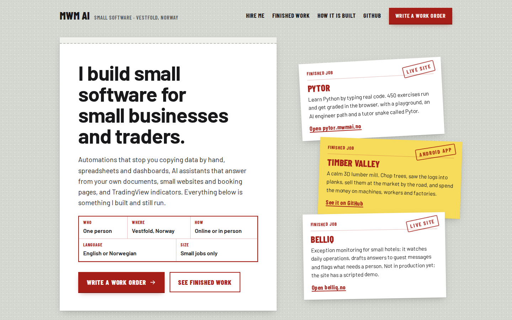

## Hei. I build things with AI. Heck, it even wrote this! 

I got no computer-science degree and no team. I started from zero in early 2025
with an AI coding assistant, and everything below runs today. **Twenty-two public repositories,
many live sites.** Nobody has paid me for any of it yet, so read this as a workshop rather
than a shop. 
I have started on my Python education, just passed my first Azure certification (AI-901) in October, and will take the AI-103 before the end of the year. Hopefully I'll land a real job doing something AI related soon! 

I am most interested in the part where AI stops being a chatbot and becomes infrastructure:
agent harnesses, tool servers, retrieval over a real corpus, and systems honest enough to tell
you when they are wrong.
My personal interest of trading and physics/philosophy aligns well with this and I have several projects currently kept private dealing with these subjects as well as what you might find here...

*The front page of mwmai.no, where the live sites, Android apps and public repos are catalogued.*

---

### Start here

**[TradingView Indicators](https://github.com/Matswm86/tradingview-indicators)**
Six free Pine Script v6 chart tools for intraday futures: EMA x VWAP Engulfing, LiqSweep+iFVG,
Liquidity Map, Po3 4H, Trend Hub and Session Pulse. The liquidity-sweep
indicator has over 200 likes on TradingView, which is the only audience number here I did not have
to qualify. Every script ships its reasoning: what it refuses to trade and why, not just where it
draws a line. More advanced indicators are available for a monthly fee via
[Whop](https://whop.com/mwm-indicators/).

**[Pytor and PyQuest](https://github.com/Matswm86/pylearn)** · live at [pytor.mwmai.no](https://pytor.mwmai.no/)
Learn Python and AI engineering from absolute zero: 450 exercises across 9 topics, executing in
your browser with no install, plus a tutor that asks questions instead of handing over answers.
The site got a new navy-and-teal look with dark mode, and its AI-901 and AI-103 drills come with
84 drag-block puzzles. The Android half, PyQuest, now lives in the same repo: 654 questions across 10 tiers and
no typing, including 157 AI-901 exam questions with choose-N answers and 222 for AI-103, because
writing Python on a phone keyboard is miserable and pretending otherwise helps nobody.

---

### Tools and agents

| Repo | What it is |
|---|---|
| [vivarium-agent-skills](https://github.com/Matswm86/vivarium-agent-skills) | A sourced reference pack for building glass habitats, written as 56 plain-Markdown files any model can read. Every number a decision rests on carries a URL; gaps say UNVERIFIED instead of guessing |
| [vibeos](https://github.com/Matswm86/vibeos) | Work in progress: a bootable AI-native Linux distribution (Ubuntu, KDE, a local model and an agent CLI) where you choose the model and the provider. No ISO download at the moment; you build it from the repo |
| [glm-free-claude-code](https://github.com/Matswm86/glm-free-claude-code) | Run free GLM 5.2 behind Claude Code: a full GLM session, one-shot offloads from a paid session, or a whole task handed to a headless GLM agent |
| [fenrir-boss](https://github.com/Matswm86/fenrir-boss) | A simulated workplace that trains you: an AI boss who assigns tickets, reviews your code and never writes it |
| [oso-sync](https://github.com/Matswm86/oso-sync) | Obsidian plus Syncthing plus Ollama: write a question in a synced note and a small Python responder appends the answer in place. Groq first, local Ollama as the fallback, or fully local if you skip the key |

### Apps and games for Android

Every one is free, with no ads, no in-app purchases and no analytics. Several ask for no
internet permission at all.

| Repo | What it is |
|---|---|
| [mwm-chess](https://github.com/Matswm86/mwm-chess) | Beginner-friendly 3D chess that shows every legal move: play the computer at four levels, a friend on one phone, or a friend online with a game code |
| [pm98-android](https://github.com/Matswm86/pm98-android) · [pcleague](https://github.com/Matswm86/pcleague) · [USM2](https://github.com/Matswm86/USM2) · [sar2007-android](https://github.com/Matswm86/sar2007-android) | Rebuilds of older football-management games from their own data, not from memory: Premier Manager 98 across 476 clubs on the original ratings (the positional match view is still being built), PcLeague 2.1 with its full 1994 database of 92 clubs and 1733 players, a playable USM2 career, and sar2007-android still at the stage of unpacking the game's files |
| [fishy](https://github.com/Matswm86/fishy) | The 2003 Flash game Fishy on Android, with its original art, music and rules: eat the smaller fish, stay away from the bigger ones |
| [krypton-egg](https://github.com/Matswm86/krypton-egg) | Krypton Egg, the Breakout game from the 1996 C2V Games Suite CD, on Android: all 100 levels, the art and the sound come off the original disc |
| [jezzball](https://github.com/Matswm86/jezzball) | Faithful Godot 4 remake of the 1992 JezzBall: swipe to wall off 70% of the field before the bouncing atoms break your walls, across 50 levels |
| [mwm-age-of-earth](https://github.com/Matswm86/mwm-age-of-earth) | Working title: a real-time strategy game for Android in the classic town-building genre, starting about 4.2 million years ago with early humans at an East African rift lake. An early playable build: the opening and the start of the first age work, while combat and computer opponents are not built yet |
| [mwm-wayfarer](https://github.com/Matswm86/mwm-wayfarer) | Working title: a realistic open-world game in which you live through human history, from the first apes in East Africa to today. The APK so far is only a graphics and performance test of a real Norwegian fjord valley; the game itself is not built yet |
| [yoda-translator](https://github.com/Matswm86/yoda-translator) | English and Norwegian to Yoda-speak, offline on the phone: a Gemma 3 1B fine-tuned for the job, with a rule engine as the fallback |
| [wiggle-and-think](https://github.com/Matswm86/wiggle-and-think) | Movement breaks for children aged 4 to 7, live at [wiggle.mwmai.no](https://wiggle.mwmai.no/), honest about what the research does and does not show |
| [rewind-quiz](https://github.com/Matswm86/rewind-quiz) | A multiplayer decades quiz for phones, live at [quiz.mwmai.no](https://quiz.mwmai.no): up to 20 players join with a 4-letter code and answer 25 or 50 questions from the 1950s to the 2000s |

### And one small one

**[manual_codes](https://github.com/Matswm86/manual_codes)** is the code I wrote by hand, myself,
without an assistant. It is currently a short list. I am keeping it separate on purpose, because the
difference between directing a build and writing it matters and I would rather label it than
blur it.

---

### How the system is engineered

AI agents write most of the code. I design the architecture, set the rules they work under,
review what comes back and decide what ships. The part I own looks like this (counts measured
2026-09-29):

| Area | What is in place |
|---|---|
| **Architecture** | About 50 projects, one repository each, around a shared core of MCP tool servers, Qdrant and Neo4j. Trading and creative work are kept apart by a guard that blocks one domain's tools in the other's sessions. Shared config has one canonical copy; syncing it into repos is an explicit step that refuses to run mid-commit |
| **Guardrails on the AI** | Around 30 Claude Code hooks at every point of an agent's turn: they block writes outside the workspace, warn before destructive shell commands and enforce 56 written rules. A change of 50+ lines to core code starts an independent reviewer agent; claims about third-party products get checked against vendor docs before I read them |
| **Separation of duties** | 32 specialist subagents split into builders and auditors. The agent that writes a backtest engine never grades it; one auditor checks the fill logic, another the results. "Tests pass" counts only with the pasted output |
| **Security** | Secret scanning (detect-secrets) on every commit in 13 repos, pip-audit in CI, strict Content-Security-Policy on the public sites. AI tools have read-only access to the trading account and no path to place an order. A prompt-injection honeypot runs weekly against a fixed pass floor |
| **CI/CD and testing** | 21 repos build and test in GitHub Actions, including every Android APK. Pre-commit runs ruff, formatting and secret checks, never skipped. Over 250 test files across the core system and the trading platform |
| **Research discipline** | Pass/fail bars are written before a backtest runs, and engines are audited for fills the market would never give you. 56 failed ideas sit in a register so nobody re-runs them hoping for luck. Anything that fails quietly must leave a tag, a counter and a log line |

### How I work

- **Measure, then claim.** Numbers in my repos carry the date they were measured. When something
  is unverified it says UNVERIFIED rather than getting a confident sentence.
- **Publish the negative results.** Most research ideas I test come back indistinguishable from
  noise, and those get written up the same as the ones that work. A study of prop-firm trading
  I ran concluded that a zero-skill trader passes the evaluation 22 to 26% of the time, which
  is not a flattering finding for the thing I was building.
- **No performance theatre.** No backtest screenshots without the fill assumptions, no profit
  claims, no "AI-powered" on something that calls an API once.

### Reach me

[mrmaxwilliam@gmail.com](mailto:mrmaxwilliam@gmail.com) · [mwmai.no](https://mwmai.no/), which now
doubles as a catalogue of every live site, Android app and public repo.

Open to consulting on agent harnesses, MCP tool servers and retrieval systems, and to back-office
automation work for small firms.
